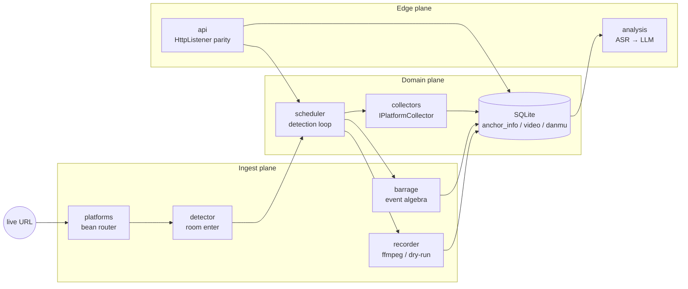

# ifupan-core

**A reconstructed live-commerce review pipeline, ported to Rust.**

> Reverse-engineered from a production Windows client (`ReviewAnalysis.exe` 2.6.3.1): Inno Setup → .NET 4.7.2 + CefSharp + Reactor-packed IL. The original binary is a thick desktop shell. The *system* underneath is a small, language-agnostic pipeline — URL classification, room probing, segmented ingest, realtime events, platform collectors, ASR/LLM diagnosis, and a local control plane.

[](https://www.rust-lang.org/)
[](LICENSE)
[](https://sqlite.org/)
[](#what-this-is)

Unofficial. Independent reconstruction of observed control flow, schema, and local HTTP surface. Not affiliated with the original vendor.

---

## Why this exists

The shipped client is ~8 MB of obfuscated IL behind a 400 MB installer, a Chromium embed, and a native recorder. Almost none of that is the product.

After recovering metadata (type names survived Reactor), `init.sql`, `config.json` beans, and RestController routes, the domain collapses to seven stages:

```
  URL ──► Probe ──► Ingest ──► Events ──► Collect ──► Diagnose ──► Control plane
 bean     room      ffmpeg     danmaku    compass      ASR+LLM     local REST
          enter     slice      wss        qianchuan
```

Rust is a better host for that pipeline than a WinForms process: explicit concurrency, a single static binary, no CLR, no CefSharp tax.

## Architecture



### Mapping from the original binary

| Observed artifact | Original type / file | This crate |
|---|---|---|
| Platform beans | `Config/config.json` | `platforms` |
| Room probe | `DouYinLive` / `KuaiShouLive` / … | `detector` |
| Native record + slice | `CppRecordUtils` + `limit_value` | `recorder` |
| Websocket event types | `DanMu` `DianZan` `JinRu` `GuanZhu` `LiWu` `RenShu` | `barrage` |
| Plugin collectors | `IPlatformCollector` / `CollectionScheduler` | `collectors` + `scheduler` |
| Schema | `script/init.sql` | `db` |
| Local REST | `RestController` + `HttpGet` | `api` |
| Post-live diagnosis | `DoubaoChatService` | `analysis` |
| Machine fingerprint | `GenerateMachineCode` → MD5 | `crypto::machine_code` |

Packed IL is not required at runtime. Method names, custom-attribute routes, and SQL were enough to rebuild the control plane.

## Domain

Four platforms, preserved as the original `platformValue` enum:

| Value | Bean | Prefix |
|---:|---|---|
| 0 | `DouYinLive` / `DouYinAppShareLive` / `DouYinHomeLive` | `live.douyin.com` `v.douyin.com` `www.douyin.com/user` |
| 1 | `TiktokLive` | `www.tiktok.com` |
| 2 | `KuaiShouLive` | `live.kuaishou.com` |
| 4 | `RedeLightLive` | `www.redelight.cn` |

Lifecycle of an anchor:

1. **Classify** the URL into a bean (prefix match, then host fallback).
2. **Probe** the room (`webcast/room/web/enter` for Douyin; HTML markers elsewhere).
3. **Schedule** on `detection_fre` (default 10s).
4. **Ingest** the FLV/HLS pull URL with ffmpeg, sliced on `limit_type=2` minutes (default 240).
5. **Fold** realtime events into `danmu` (`WebcastChatMessage` → `DanMu`, …).
6. **Collect** optional backend adapters (Compass / Qianchuan — cookie-gated; stubs retain observed endpoints).
7. **Diagnose** after stop: demux 16 kHz mono → ASR hook → chat-completions report.

SQLite is the system of record (`anchor_info`, `anchor_video`, `online_num`, `danmu`, `config`). Same column names as the installer scripts, including historical typos (`vedio_sizie`, `is_rocord`) where the original client would otherwise disagree.

## Control plane

The desktop UI talked to a loopback `HttpListener`, not to the cloud directly. Routes recovered from `HttpGetAttribute` / `RestControllerAttribute` blobs:

| Method | Path | Role |
|---|---|---|
| `GET` | `/api/system/getMachineCode` | hardware MD5 |
| `GET` | `/api/config/getuserinfo` | session projection |
| `GET` | `/api/config/settoken` | token inject |
| `GET` | `/api/anchorinfo/GetPageAnchor` | roster |
| `POST` | `/api/anchorinfo/AddOrUpdateAnchor` | `{ "url": "…" }` |
| `GET` | `/api/anchorinfo/Decector` | start detection *(original spelling)* |
| `GET` | `/api/anchorinfo/StopDecector` | stop detection |
| `GET` | `/api/anchorinfo/StartRecord?id=` | force ingest |
| `GET` | `/api/anchorinfo/StopRecord?id=` | stop ingest |
| `GET` | `/api/anchorvideo/list` | segments |
| `POST` | `/api/anchorvideo/CreateAnalysis` | ASR + LLM |

Wire format matches the vendor envelope: `{ "code": 0, "msg": "ok", "data": … }`. Unknown paths return `{ "code": -9, "msg": "资源不存在" }`.

## Crate layout

```
src/
├── main.rs          CLI: probe | add | list | serve
├── lib.rs           public surface + invariant tests
├── platforms.rs     bean router
├── detector.rs      room enter / HTML probes
├── recorder.rs      ffmpeg segmenter, dry-run fallback
├── barrage.rs       webcast method → DanmuType
├── collectors.rs    live-meta / juliang / qianchuan
├── scheduler.rs     detection thread + auto-record
├── analysis.rs      ffmpeg demux + Ark chat completions
├── api.rs           std TCP JSON server (no tokio)
├── db.rs            rusqlite, bundled libsqlite3
├── crypto.rs        machine-code MD5
├── models.rs        domain types
└── pipeline.rs      composition root
```

Deliberate constraints:

- **No async runtime.** Detection, ffmpeg, and the HTTP server are threads. The original client was thread-pool WinForms; matching that model keeps the rewrite honest.
- **ffmpeg as the recorder.** `librecord.dll` is a Windows-only blob. Copy-codec slice (`-c copy -t N`) is the portable equivalent of `limit_value`.
- **Dry-run without ffmpeg.** Writes an `FLV\x01` placeholder so the scheduler can be tested on a laptop.
- **Collectors are capability-gated.** Compass endpoints are known; authorization is not forged.

## Build

```bash
rustc 1.70+
cargo test
cargo run -- probe https://live.douyin.com/<web_rid>
cargo run -- add  https://live.douyin.com/<web_rid>
cargo run -- list
cargo run -- serve --host 127.0.0.1 --port 5001
```

Room enter is cookie-sensitive. Unauthenticated Douyin probes often return a non-JSON challenge (`error: "bad json"`) — classification still succeeds. Ingest requires `ffmpeg` on `PATH`.

Optional: `ARK_API_KEY` enables Volcengine Ark completions (`doubao-pro-32k`). Without it, diagnosis returns a structured placeholder.

## Design notes

**Reconstruction, not a decompile.** Reactor NecroBit maps ~14k methods onto a single FOAP stub. Recovering CIL is a Windows-side unpack. This crate never executes or patches that blob; it reimplements the *observable* machine: SQL, attributes, literals, HTTP.

**The UI is not the product.** CefSharp loaded a remote web shell (`GetWebServerUrl`) that called loopback REST. Replacing Chromium with `serve` is a stricter separation of concerns than the original.

**HWID is MD5, not TPM.** OpenAPI field `ComputerConfigBo.cpuId` is documented as「机器码MD5」. `crypto::machine_code` concatenates cpu/disk/board and hashes. No vendor-binding is implemented here.

**Slice policy lives in `config`.** `limit_type = 2` means duration (minutes); `limit_value = "240"` is a four-hour segment. Size-based slicing (`limit_type = 1`) is represented in the schema and left for a later pass.

## Status

Implemented and tested: URL algebra, SQLite roster, local REST, detection loop, ffmpeg/dry-run ingest, danmaku type map, diagnosis hook.

Not in scope: the original Chromium UI, enterprise Compass cookie sessions, Reactor unpacking, installer scripts.

```
cargo test
# 7 passed  — router, store, barrage map, machine-code, REST dispatch
```

## License

MIT. See [LICENSE](LICENSE).
